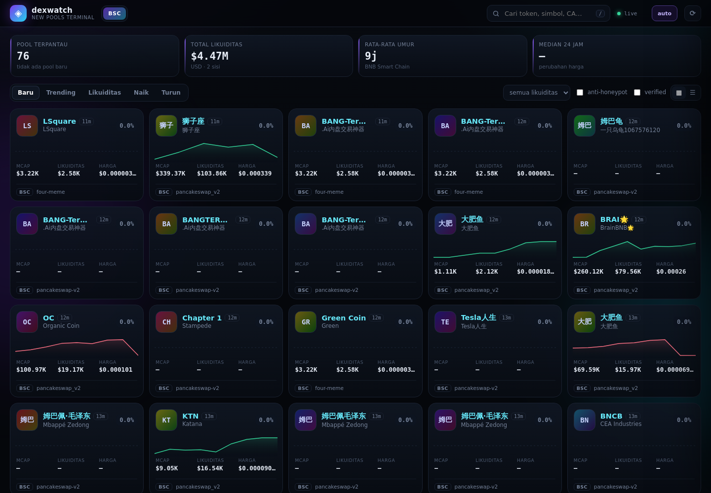
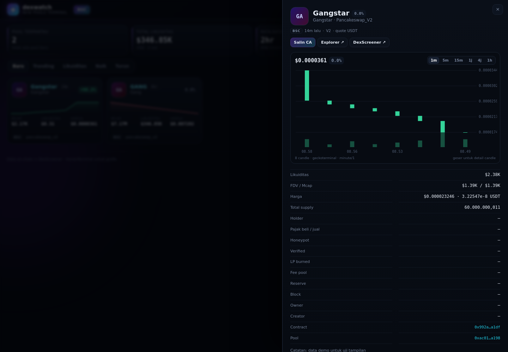

# dexwatch — pemantau koin baru di DEX

Program untuk menampilkan **pool/koin yang baru didaftarkan di DEX** secara detail:
nama token, alamat contract, likuiditas (native + USD), harga, market cap, holder,
pajak beli/jual, status verifikasi, LP terbakar, dan link explorer.

Data diambil **langsung dari event on-chain** (`PairCreated` / `PoolCreated`), lalu
diperkaya dengan DexScreener (harga & likuiditas USD) dan GoPlus (holder, pajak,
honeypot). Tanpa API key, tanpa dependensi Python eksternal — cukup Python 3.10+.

## Mulai cepat

```bash
cd /root/deep/dexwatch

# 1) lihat pool baru dalam 300 block terakhir (sekali jalan)
./dexwatch.sh new

# 2) pantau real-time (Ctrl+C untuk berhenti)
./dexwatch.sh watch

# 3) detail satu token / pool
./dexwatch.sh detail 0x0E09FaBB73Bd3Ade0a17ECC321fD13a19e81cE82

# 4) dashboard web lokal (gaya pump.fun / GMGN)
./dexwatch.sh serve --scan
# buka http://127.0.0.1:8787
```

Tanpa wrapper: `python3 -m dexwatch <perintah>` dari folder ini.
Menjalankan di GitHub Codespaces: lihat [CODESPACES.md](CODESPACES.md).

## Perintah

| Perintah | Fungsi |
|---|---|
| `new --blocks N` | pindai N block terakhir, tampilkan tabel pool baru |
| `watch` | pantau terus-menerus; pool tanpa likuiditas dicek ulang (`--recheck 45`, 0 = mati) |
| `detail <alamat>` | detail lengkap token **atau** pool (alamat pair) |
| `doctor` | cek RPC, alamat factory, event, DexScreener & GoPlus |
| `export` | ekspor isi database (tabel / `--json` / `--csv`) |
| `serve` | dashboard web dari database; `--scan` sekaligus memantau, `--refresh 25`, `--no-sampler` |

Opsi umum: `--chain bsc|ethereum|base|arbitrum`, `--dex nama1,nama2`,
`--min-liq 5000`, `--json`, `--csv`, `--no-security`, `--offline`,
`--db file.db`, `--rpc URL` (boleh berulang), `--width`, `--no-color`, `-v`.

Contoh:

```bash
# hanya PancakeSwap V2, sembunyikan likuiditas < $5.000, keluaran JSON
./dexwatch.sh watch --dex pancakeswap-v2 --min-liq 5000 --json

# token/pool terbaru di Base, urut likuiditas
./dexwatch.sh new --chain base --blocks 500 --sort liq

# cek semua endpoint & alamat factory
./dexwatch.sh doctor --chain ethereum

# ekspor 100 pool terakhir ke CSV
./dexwatch.sh export --limit 100 --csv > pool.csv
```

## Dashboard web (gaya pump.fun / GMGN)

`./dexwatch.sh serve` menyajikan terminal pool baru di `http://127.0.0.1:8787`:





*Contoh tampilan dengan data uji.*

- **Card grid** — avatar/logo token (fallback inisial gradien), simbol, nama, umur,
  perubahan 24 jam, sparkline, market cap, likuiditas, harga, holder/pajak, badge
  keamanan (honeypot, pajak tinggi, verified, LP rendah), ikon sosial.
- **Tab** Baru / Trending / Likuiditas / Naik / Turun, filter likuiditas minimum,
  anti-honeypot, verified, dan pencarian simbol/nama/contract.
- **Tampilan daftar** (☰) untuk mode padat ala GMGN; grid (▦) untuk mode kartu.
- **Klik kartu** → drawer detail: candlestick (1m/5m/15m/1j/4j/1h dari GeckoTerminal),
  statistik lengkap, peringatan keamanan, salin contract, link explorer/DexScreener.
- **Live** — auto-refresh 5 detik; data pasar DexScreener di-cache 25 detik di server.
  Sparkline memakai snapshot harga lokal yang dicatat sampler tiap ~45 detik, jadi
  grafiknya terisi setelah dashboard berjalan beberapa menit.
- **Multi-chain** — kalau database berisi lebih dari satu chain, pil chain muncul
  otomatis di header.

Opsi: `--port 8787`, `--host 127.0.0.1`, `--refresh 25` (detik sampler),
`--no-sampler`, `--scan` (tambahkan pool baru di background), `--db file.db`.
UI tetap menampilkan data on-chain dari database saat internet mati; chart dan
perubahan harga butuh akses ke DexScreener/GeckoTerminal.

## Kolom tabel

```
UMUR  DEX  TOKEN  CONTRACT  LIKUIDITAS  HARGA  MCAP  HOLDER  PAJAK  LP BURN  CATATAN
```

- **UMUR** — usia pool sejak block pembuatan (`s`/`m`/`j`/`hr`).
- **LIKUIDITAS** — nilai USD (dua sisi); hijau ≥ $50K, kuning ≥ $5K, merah di bawahnya.
- **HARGA / MCAP** — harga USD dan FDV estimasi (harga × total supply).
- **HOLDER / PAJAK** — dari GoPlus (kalau tersedia); `pajak` = beli/jual.
- **LP BURN** — persentase LP token yang dikirim ke `0x…dEaD`/`0x0` (V2).
- **CATATAN** — honeypot, pajak tinggi, belum verified, LP belum burn, dll.
- `--min-liq N` menyembunyikan pool yang likuiditas USD-nya **belum diketahui**
  (bukan hanya yang di bawah N), karena threshold tidak bisa diverifikasi.

Detail (`detail` atau klik baris di dashboard) menampilkan contract, pool, quote,
total supply, reserve, LP supply, fee pool, block/tx, owner, creator, web/sosial,
sumber data, dan link ke explorer + DexScreener.

Contoh keluaran:

```
UMUR   DEX              TOKEN                CONTRACT        LIKUIDITAS   HARGA          MCAP     HOLDER  PAJAK  LP BURN  CATATAN
2m     pancakeswap-v2   GAN GangFi          0x0bb5…ddc2     $70.2K       $0.000168      $167.8K  312     2/3%   99%      -
1m     pancakeswap-v3   AGI A Gangstar Inu  0xf38c…9a28     $743.5       $0.00000074    $31.1K   0       0/0%   -        likuiditas V3 = perkiraan…
30s    pancakeswap-v2   NEW NewToken        0x1234…7777     -            -             -        -       -      -        belum ada likuiditas
```

## Chain & DEX yang didukung

| Chain | DEX |
|---|---|
| BSC | PancakeSwap V2/V3, Biswap V2, ApeSwap V2 |
| Ethereum | Uniswap V2/V3, SushiSwap V2 |
| Base | Uniswap V2/V3, Aerodrome |
| Arbitrum | Uniswap V3, SushiSwap V2 |

Menambah DEX cukup tambah `Dex(...)` di `dexwatch/chains.py` (alamat factory +
jenis `v2`/`v3`/`aerodrome`). Menambah chain: tambah `Chain(...)` di `CHAINS`
(RPC, wrapped native, stablecoin, explorer, daftar DEX). Event dideteksi otomatis
dari signature, jadi tidak perlu hardcode topic hash.

## Cara kerja

1. **Deteksi** — `eth_getLogs` pada alamat factory untuk event `PairCreated`
   (V2), `PoolCreated` (V3), `PoolCreated` (Aerodrome), dengan rentang block
   adaptif karena RPC publik punya batas berbeda-beda.
2. **Decode** — token0/token1/pool/fee dibaca dari topic & data log.
3. **Perkaya** — satu batch `eth_call` per pool: `token0/token1`, `getReserves`
   atau `slot0`+`liquidity`, `totalSupply` LP, `name/symbol/decimals/totalSupply`
   token, `fee`, `balanceOf(0xdEaD)`.
4. **Harga & USD** — harga native dihitung on-chain; harga 1 native (BNB/ETH)
   diambil dari pool stable on-chain (fallback DexScreener); likuiditas USD dari
   DexScreener bila tersedia, kalau tidak dihitung dari reserve.
5. **Keamanan** — GoPlus: jumlah holder, top-10, pajak, honeypot, verified, owner,
   creator (di-throttle ±1 request/detik, boleh dimatikan dengan `--no-security`).
6. **Simpan** — SQLite (`dexwatch.db`) untuk dedupe + histori; dashboard membaca
   database yang sama.

## Batasan (penting)

- **Likuiditas V3 adalah perkiraan** dari likuiditas aktif pada tick sekarang,
  bukan total seluruh posisi. Nilai USD dari DexScreener lebih akurat bila ada.
- **Harga USD** bergantung pada DexScreener; untuk pool yang sangat baru (belum
  terindeks) yang tampil hanya harga native + likuiditas on-chain.
- **GoPlus gratis punya rate limit**; sebagian pool bisa tampil tanpa holder/pajak.
  Jalankan `doctor` untuk memastikan API merespons.
- **Honeypot = indikasi**, bukan jaminan. Selalu cek sendiri sebelum beli.
- **Logo token** hanya muncul bila DexScreener punya profil untuk token itu; kalau
  tidak, UI memakai inisial dengan gradien. Chart butuh pool terindeks GeckoTerminal
  dan minimal satu trade. Pool yang sangat baru bisa belum punya candle.
- **RPC publik** bisa membatasi `eth_getLogs`/rate limit; `--rpc` bisa diarahkan
  ke endpoint berbayar (Alchemy/QuickNode/Ankr) untuk pemakaian intensif.
- Deteksi memakai event factory resmi. Pool dari DEX yang belum dikonfigurasi
  tidak akan muncul (tambahkan di `chains.py`).

## Struktur

```
dexwatch/
├── dexwatch.sh          # wrapper
├── dexwatch/
│   ├── chains.py        # konfigurasi chain + alamat factory
│   ├── rpc.py           # JSON-RPC: failover, throttle, getLogs adaptif
│   ├── abi.py           # encode/decode ABI + selector/topic
│   ├── keccak.py        # keccak-256 murni Python
│   ├── pools.py         # model + decode event pool
│   ├── mathx.py         # rumus harga/likuiditas V2 & V3
│   ├── enrich.py        # metadata on-chain + DexScreener + GoPlus
│   ├── scanner.py       # deteksi, pengayaan paralel, watch + recheck
│   ├── store.py         # SQLite (dedupe, histori, snapshot harga)
│   ├── render.py        # tabel, detail, JSON/CSV
│   ├── market.py        # DexScreener + GeckoTerminal untuk UI
│   ├── web.py           # server dashboard + sampler
│   ├── static/          # index.html, app.css, app.js (UI)
│   └── cli.py           # argparse & perintah
└── tests/test_core.py   # tes offline (keccak, ABI, math, decode, store, UI merge)
```

## Tes

```bash
python3 -m unittest discover -s tests -v   # 20 tes offline
./dexwatch.sh doctor          # tes hidup: RPC, factory, event, API
```

> Bukan nasihat keuangan. Tool ini hanya menampilkan data on-chain & pasar.
